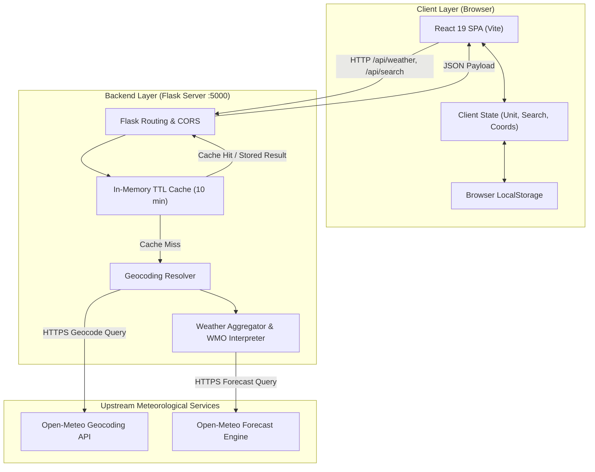
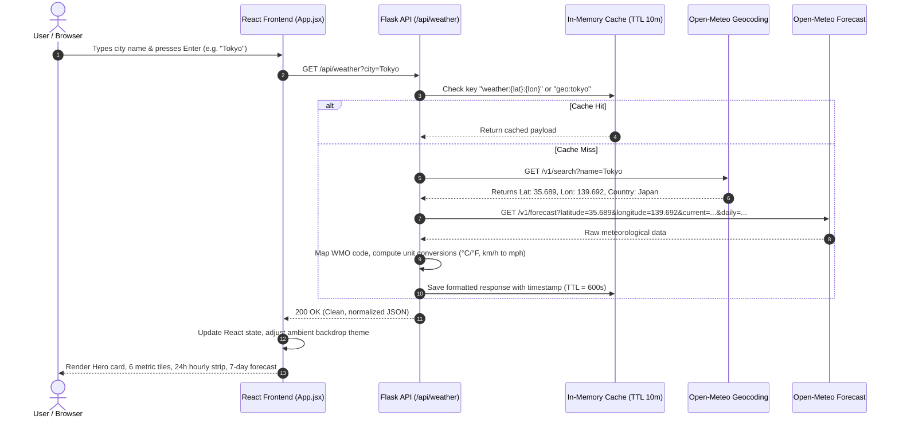

# System Architecture — SkyCast Weather Application

SkyCast is a modern, responsive, one-page weather dashboard built with a **Flask (Python)** REST API backend and a **React (Vite)** frontend. It delivers real-time meteorological conditions, 24-hour hourly progressions, and 7-day extended forecasts for any city across the globe with zero mandatory API keys.

---

## 1. High-Level Architecture Overview

The system is designed with a decoupled client-server pattern featuring two primary runtime topologies:
1. **Development Mode**: Decoupled architecture where Vite serves the React single-page application (SPA) with Hot Module Replacement (HMR) and reverse-proxies API calls to the local Flask backend.
2. **Unified Production Mode**: Flask acts as both the RESTful API microservice and the static asset server, serving the pre-compiled Vite production bundle directly from `frontend/dist`.



---

## 2. Request Lifecycle & Sequence Diagram

The following diagram illustrates the lifecycle of a city search request from user input down to upstream geocoding and caching:



---

## 3. Frontend Architecture (React)

The frontend is structured as a component-driven, single-page application built on Vite and modern CSS.

```
frontend/src/
├── main.jsx                 # React root initialization
├── App.jsx                  # Main orchestrator & application state
├── index.css                # Glassmorphic UI styling & responsive themes
└── components/
    ├── SearchBar.jsx        # Search input, debounced live autocomplete, quick chips
    ├── CurrentWeather.jsx   # Hero card (city, temp, high/low, feels like, badge)
    ├── WeatherMetrics.jsx   # 6 key metrics (wind, humidity, UV gauge, pressure, sun cycle, rain)
    ├── HourlyForecast.jsx   # 24-hour horizontal scrollable card strip
    ├── DailyForecast.jsx    # 7-day outlook with temperature bars and rain probability
    ├── WeatherIcon.jsx      # Lucide icon mapper for WMO conditions (day/night aware)
    └── SkeletonLoader.jsx   # Pulsing skeleton state during network loading
```

### Component Responsibilities

1. **`App.jsx`**:
   - Manages centralized state: `weatherData`, `unit` (`'C'` | `'F'`), `loading`, `error`, `currentCity`.
   - Coordinates HTML5 Geolocation (`navigator.geolocation`) for instant 1-click local weather.
   - Synchronizes persistent user preferences with browser `localStorage`.
   - Computes dynamic ambient background styles (`.theme-clear`, `.theme-clouds`, `.theme-rain`, `.theme-snow`, `.theme-storm`, `.theme-fog`) based on the active weather condition.

2. **`SearchBar.jsx`**:
   - Implements a 300ms debounced search effect calling `/api/search?q={query}`.
   - Renders interactive dropdown suggestions with keyboard navigation and click-outside dismissal.
   - Provides quick-access pills for prominent global cities (Tokyo, London, New York, Paris, etc.).

3. **`CurrentWeather.jsx`**:
   - Serves as the primary focal card with large hero temperature typography.
   - Automatically re-computes Celsius and Fahrenheit values instantaneously when toggled.
   - Displays day/night sensitive icons and condition indicators.

4. **`WeatherMetrics.jsx`**:
   - Surfaces granular telemetry: Wind Speed & Compass Direction, Relative Humidity, UV Index with color-coded safety rating (Low, Moderate, High, Extreme), Barometric Pressure, Sunrise/Sunset time formatters, and Current Precipitation volume.

5. **`HourlyForecast.jsx`**:
   - Slices the immediate 24-hour progression from current hour onward.
   - Features customized horizontal scrollbar behavior and individual hourly cards.

6. **`DailyForecast.jsx`**:
   - Highlights the 7-day forecast with day-of-week abbreviations, condition icons, rain probabilities, and min/max temperature bands.

---

## 4. Backend Architecture (Flask)

The Flask backend is built as an ultra-lightweight, resilient microservice responsible for data aggregation, rate-limit shielding, unit conversion, and WMO code interpretation.

```
backend/
├── app.py               # Main Flask server, routing, caching, and upstream client
├── requirements.txt     # Python package dependencies
├── .env.example         # Configuration template
└── test_app.py          # Automated unit & integration tests
```

### Core Backend Modules & Subsystems

1. **WMO Interpretation Engine**:
   - The World Meteorological Organization (WMO) codes (0–99) returned by meteorological satellites are translated into standardized condition names, visual design categories (`clear`, `clouds`, `rain`, `snow`, `storm`, `fog`), and icon IDs.

2. **In-Memory TTL Caching Engine**:
   - Stores geocoded cities and coordinates in an in-memory dictionary with a 600-second (10-minute) expiration timestamp.
   - Eliminates redundant upstream HTTP calls, protects against third-party rate limits, and achieves sub-10ms response times for repeated queries.

3. **Unit Conversion Utility**:
   - Server-side precomputes both Metric and Imperial values (`temperature_c`, `temperature_f`, `wind_speed_kmh`, `wind_speed_mph`) so the client can swap units instantaneously without firing additional network requests.

4. **SPA Static Serving Route**:
   - Implements catch-all routing (`/` and `/<path:path>`) pointing to `frontend/dist` when the React bundle is compiled.

---

## 5. REST API Specifications

### `GET /api/weather`
Fetches complete weather information for a specified city or coordinate pair.

**Query Parameters:**
| Parameter | Type | Required | Description |
|-----------|------|----------|-------------|
| `city` | string | Optional* | City name (e.g., `Paris`, `Toronto`) |
| `lat` | float | Optional* | Latitude coordinate |
| `lon` | float | Optional* | Longitude coordinate |

*\*Either `city` OR both `lat` & `lon` must be supplied.*

**Sample Response (Truncated for brevity):**
```json
{
  "location": {
    "name": "Tokyo",
    "country": "Japan",
    "country_code": "JP",
    "region": "Tokyo",
    "latitude": 35.6895,
    "longitude": 139.6917,
    "timezone": "Asia/Tokyo"
  },
  "current": {
    "temperature_c": 19.1,
    "temperature_f": 66.4,
    "feels_like_c": 18.5,
    "feels_like_f": 65.3,
    "humidity": 55,
    "wind_speed_kmh": 14.2,
    "wind_speed_mph": 8.8,
    "wind_direction_deg": 180,
    "pressure_hpa": 1014.2,
    "precipitation_mm": 0.0,
    "weather_code": 1,
    "condition": "Mainly clear",
    "category": "clear",
    "icon": "sun",
    "is_day": true,
    "time": "2026-10-07T05:00"
  },
  "metrics": {
    "uv_index": 5.4,
    "sunrise": "2026-10-07T05:40",
    "sunset": "2026-10-07T17:18",
    "precipitation_mm": 0.0,
    "pressure_hpa": 1014.2
  },
  "hourly": [
    {
      "time": "2026-10-07T05:00",
      "temp_c": 19.1,
      "temp_f": 66.4,
      "pop_percent": 0,
      "weather_code": 1,
      "condition": "Mainly clear",
      "icon": "sun"
    }
  ],
  "daily": [
    {
      "date": "2026-10-07",
      "temp_max_c": 22.4,
      "temp_max_f": 72.3,
      "temp_min_c": 14.2,
      "temp_min_f": 57.6,
      "precipitation_prob_max": 10,
      "uv_index_max": 5.4,
      "sunrise": "2026-10-07T05:40",
      "sunset": "2026-10-07T17:18",
      "weather_code": 1,
      "condition": "Mainly clear",
      "icon": "sun"
    }
  ],
  "cached": false,
  "fetched_at": 1728263900
}
```

### `GET /api/search`
Provides city autocomplete options.

**Query Parameters:**
| Parameter | Type | Required | Description |
|-----------|------|----------|-------------|
| `q` | string | Yes | Query string (minimum 2 characters) |

**Sample Response:**
```json
{
  "results": [
    {
      "name": "London",
      "country": "United Kingdom",
      "country_code": "GB",
      "region": "England",
      "latitude": 51.50853,
      "longitude": -0.12574,
      "timezone": "Europe/London"
    }
  ]
}
```

### `GET /api/health`
Health check endpoint reporting backend service status and cached query volume.

---

## 6. Resilience & Fault Tolerance Strategy

1. **Zero-Configuration Public API**:
   - Uses Open-Meteo, which avoids rate-limit exhaustion common to shared demo keys, requires no credit card or account registration, and offers high availability.
2. **Graceful Error Recovery**:
   - If an unrecognized city name is queried, the API returns a friendly `404 Not Found` with actionable suggestions rather than crashing.
   - Upstream service issues are caught and returned as `502 Bad Gateway` while client state remains intact with a Retry action.
3. **Client-Side Graceful Degradation**:
   - If the browser blocks geolocation permissions, the UI catches the exception, informs the user cleanly, and keeps the search bar fully accessible.

---

## 7. Security & Best Practices

- **CORS Restrictions**: Configured specifically for cross-origin resource sharing on `/api/*` endpoints.
- **Input Sanitization**: Query parameters are stripped, type-validated, and URL-encoded before passing to upstream services.
- **Client Cache Isolation**: LocalStorage preferences are isolated by domain keys (`weather_unit`, `last_searched_city`).

